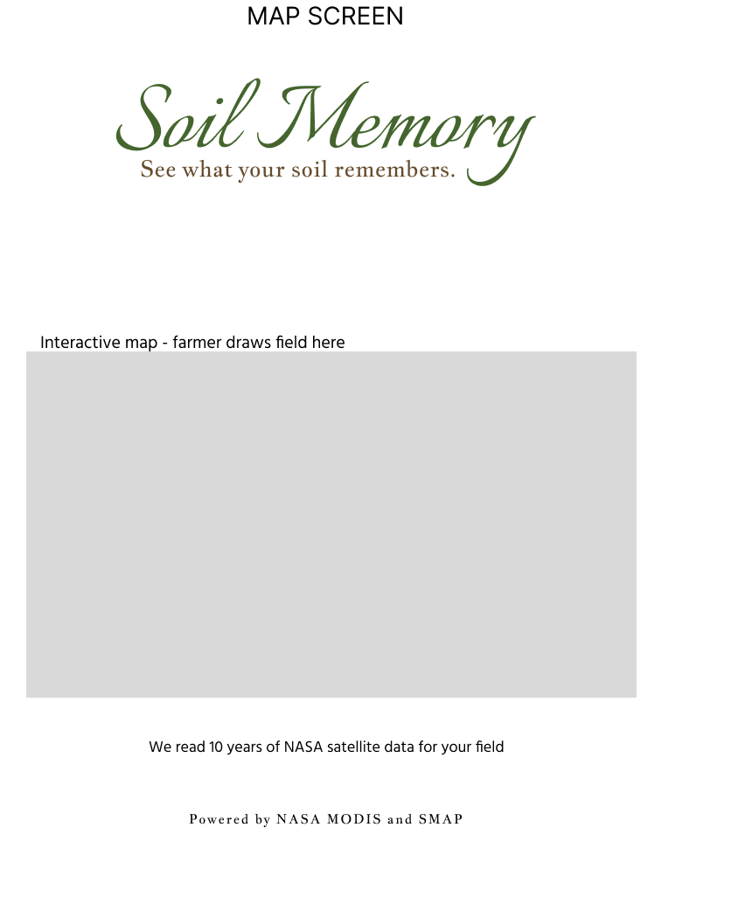
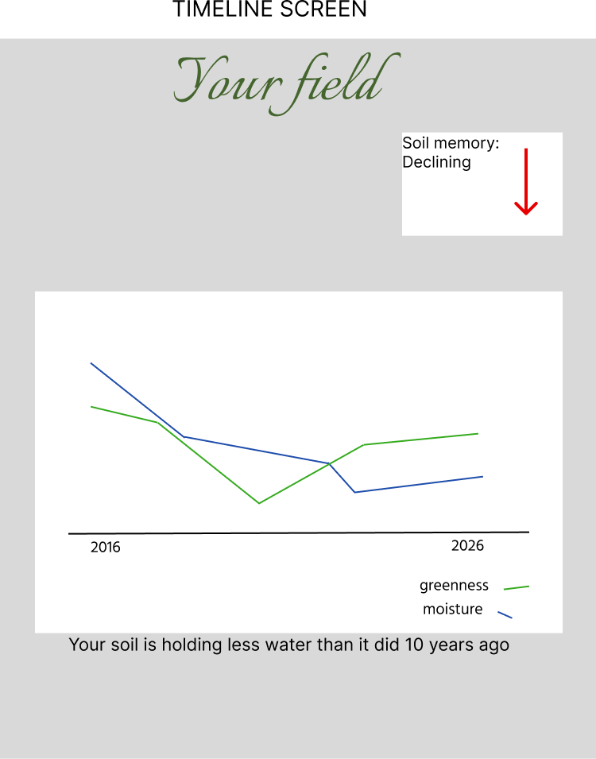
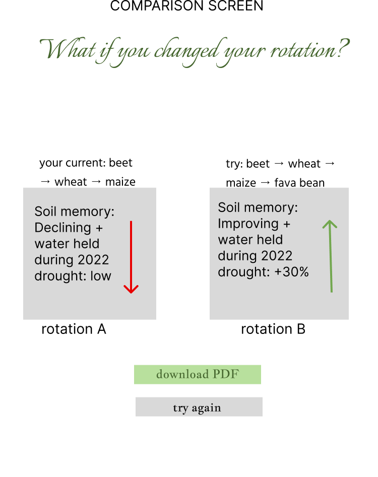

## 🚀 Live Dashboard
[Click here to view the live Soil Memory App](https://soil-memory-uhg3wqs4a6mvsxzvk4lxhx.streamlit.app/)
Soil Memory is a decision-support tool that uses NASA satellite data to help farmers see the long-term impact of their crop rotations on soil health. By reading a decade of MODIS vegetation data and SMAP soil moisture data, the tool reconstructs a field’s “soil memory”, its historical trajectory of carbon and moisture, and lets farmers simulate how different rotations could strengthen or weaken that memory. Farmers can test ideas before planting a single seed, turning invisible soil degradation into a clear, evidence-based story.

## Design Preview

| Map Screen | Timeline Screen | Comparison Screen |
|---|---|---|
|  |  |  |
